# alertfuse

**Fuse an alert stream into an incident queue.** Collapse the same attack reported by five tools into one triage entry, with an auditable reason for every merge.

[](https://www.python.org/)
[](pyproject.toml)
[](#testing)
[](LICENSE)
[](#security-posture)
[](#ci-gating)

---

## The problem

A single SSH brute-force campaign that succeeds does not arrive as one alert. It arrives as six:

| Tool | Alert |
| --- | --- |
| Wazuh | SSH Brute Force Detected |
| Suricata | ssh_brute_force |
| Wazuh | SSH Brute Force Detected *(again, next minute)* |
| EDR | Successful SSH Login After Repeated Failures |
| EDR | Suspicious Outbound Traffic |
| Suricata | C2 Beacon Pattern |

An analyst opens six tickets, re-reads the same host and user six times, and closes five as duplicates. Multiply by a shift, a week, an estate. Survey after survey lands on the same number: the large majority of SOC analysts report being overwhelmed by alert volume and false positives, and duplicate alerting is a leading cause.

SIEM correlation rules help, but they are expensive to write, live inside one product, and are opaque when they fire. `alertfuse` does the boring, high-value part offline: normalize the alerts, group the ones that describe the same actor and asset, and show why.

**Measured on the bundled 12-alert sample: 12 alerts to 3 incidents, 72.7% of rows removed, 2 incidents where independent tools agreed.**

---

## What it does

```text
alerts_in ──► normalize ──► correlate ──► rank ──► triage queue
              (severity,    (anchor       (worst
               entities,     entities +    first)
               time)         time window)
```

1. **Ingest** JSON arrays or NDJSON from any exporter. Field names are matched by alias, so ECS (`user.name`, `host.name`, `source.ip`), Wazuh, Suricata, Windows event style and hand-rolled webhook payloads all read the same way.
2. **Normalize** severity to one five-level scale, and entities to one canonical spelling. `WS01.corp.local`, `ws01` and `WS01:3389` become `ws01`. `10.0.0.5:51234` becomes `10.0.0.5`.
3. **Correlate** with an explicit, readable rule set (below), recording a reason for every merge.
4. **Rank** incidents worst first, and optionally raise one severity step when independent tools agree.
5. **Report** a terminal triage queue and/or JSON, with optional allowlist suppression that is always disclosed.

### Why entities, not rules

Rule-based correlation breaks the moment a second vendor names the same detection differently. `SSH Brute Force Detected` and `ssh_brute_force` look unrelated to a string comparison but identical to an analyst. `alertfuse` uses fingerprints (case, whitespace and punctuation folded) for *repeat* detection, and shared **anchor entities** (user, host, IP, file hash) for *cross-detection* correlation. That is what lets a Wazuh brute-force alert fuse with a Suricata network alert and an EDR logon alert into one critical incident.

---

## Architecture

```mermaid
flowchart TD
    A["alerts.json / alerts.ndjson<br/>edr · wazuh · suricata · idp · av"] --> B[ingest.py]
    B -->|load_json_records| B1["array | NDJSON | nested<br/>alerts/events/results"]
    B -->|parse_timestamp| B2["epoch s/ms · ISO-8601<br/>offsets · syslog"]
    B --> C[flatten.py]
    C -->|dotted paths| D[entities.py]
    D -->|"normalize_host / normalize_ip"| D1["ws01.corp.local --> ws01<br/>ip:port --> ip"]
    B --> E[models.py]
    E -->|normalize_severity| E1["sev5 / P1 / 9.8 / warning<br/>--> critical · high · medium · low · info"]

    D --> F[suppress.py]
    E --> F
    F -->|keep| G[cluster.py]
    F -->|suppress + rule name| Z["reported, never silent"]

    G -->|"fingerprint + anchor entity<br/>inside window"| G1["Incident"]
    G1 --> G2["severity bump when<br/>2+ tools agree"]
    G2 --> H[report.py]
    H --> I["triage queue (text)"]
    H --> J["JSON report"]
    H --> K["exit code for CI"]

    SC[("ClusterConfig<br/>window · min_shared")] -.-> G
    AL[("allowlist.json<br/>match + reason")] -.-> F

    style G fill:#1f6feb,color:#fff
    style Z fill:#8b5cf6,color:#fff
    style I fill:#238636,color:#fff
    style J fill:#238636,color:#fff
    style K fill:#238636,color:#fff
```



### Correlation rule, in full

An alert joins an existing incident when **both** hold:

1. **Time** - it falls within `window_seconds` of the incident's *latest* alert. Measuring from the latest alert, not the first, lets a long campaign keep collapsing without letting tomorrow's activity in.
2. **Linkage** - one of:
   - **Repeat:** same detection fingerprint, and at least one shared entity (strong *or* weak). Same rule firing again on the same host is a repeat by definition.
   - **Chain:** a *different* detection sharing at least `min_shared` **anchor** entities (`user`, `host`, `ip`, `hash`).

**Weak entities** (`process`, `parent_process`, `file`, `domain`) never merge different detections on their own. `cmd.exe` appears on ten thousand endpoints a day; treating it as a correlation key would fuse the estate into a single incident. It is still enough to tie a repeat of the same detection together.

When several incidents could claim an alert, the one with the most overlapping anchor entities wins. When nothing links, a new incident starts.

---

## Install

No dependencies, and no install step required if you just want to run it.

```bash
git clone https://github.com/mehulpatel23b-pixel/alertfuse.git
cd alertfuse

# Option A - run straight from the clone
./bin/alertfuse --help

# Option B - install the console script
pip install .
alertfuse --help

# Option C - as a library
PYTHONPATH=src python3 -c "import alertfuse; print(alertfuse.__version__)"
```

Requires Python 3.8 or newer. Standard library only.

---

## Usage

### The thirty-second demo

```bash
./bin/alertfuse examples/alerts.json --allowlist examples/allowlist.json --tz ist
```

```text
alertfuse  12 alerts -> 3 incidents
noise removed 72.7%   cross-tool incidents 2   suppressed 1
by severity: critical=2  medium=1

#1 [CRITICAL] 6 alerts  2026-11-18 14:32:11 -> 2026-11-18 14:41:02
------------------------------------------------------------------------------------------------
  tools  : edr, suricata, wazuh
  host   : jump01
  ip     : 203.0.113.44, 10.20.4.11, 198.51.100.77
  process: sshd
  user   : svc_backup
  detections:
    2026-11-18 14:32:11  high      wazuh          SSH Brute Force Detected
    2026-11-18 14:33:02  high      suricata       ssh_brute_force
    2026-11-18 14:34:48  high      wazuh          SSH Brute Force Detected
    2026-11-18 14:36:20  critical  edr            Successful SSH Login After Repeated Failures
    2026-11-18 14:39:55  high      edr            Suspicious Outbound Traffic
    2026-11-18 14:41:02  high      suricata       C2 Beacon Pattern
  why merged: first alert; shares ip:203.0.113.44 with incident; repeat of 'SSH Brute Force Detected' on host:jump01; shares host:jump01, user:svc_backup with incident
```

Six rows became one incident, and the queue says exactly why each row joined.

### Real workflows

```bash
# Combine exports from several tools into one queue
./bin/alertfuse wazuh.json suricata.ndjson edr.json --json report.json

# Tight window for a live shift review
./bin/alertfuse shift.json --window 10m --limit 10

# Only merge different detections when two strong entities agree
./bin/alertfuse alerts.json --min-shared 2

# Stream from a pipeline
cat alerts.ndjson | ./bin/alertfuse -

# Ask for no severity bump from cross-tool agreement
./bin/alertfuse alerts.json --limit 5    # bump is on by default; see ClusterConfig
```

### Options

| Flag | Default | Meaning |
| --- | --- | --- |
| `-w, --window` | `900` (15m) | Correlation window. Accepts `90s`, `15m`, `2h`, `1d`, or bare seconds. |
| `--min-shared` | `1` | Anchor entities required to merge *different* detections. |
| `--allowlist` | none | JSON suppression rules (see below). |
| `--json` | none | Write the structured report to a file. |
| `--tz` | `utc` | Display timezone, `utc` or `ist`. |
| `--fail-on` | `none` | Exit `1` when an incident reaches `medium`, `high` or `critical`. |
| `--limit` | `0` (all) | Show only the top N incidents. |
| `--quiet` | off | Suppress the text queue but still write JSON. |

### As a library

```python
from alertfuse import ClusterConfig, build_incidents, load_alerts, render_text

records = [
    {"timestamp": "2026-11-18T09:02:11Z", "rule": "SSH Brute Force",
     "severity": "high", "source_tool": "wazuh",
     "user": {"name": "svc_backup"}, "host": {"name": "JUMP01.corp.local"}},
    {"timestamp": "2026-11-18T09:04:48Z", "rule": "ssh_brute_force",
     "severity": "high", "source_tool": "suricata",
     "host": {"name": "jump01"}, "src_ip": "203.0.113.44"},
]

alerts = load_alerts(records)
incidents = build_incidents(alerts, ClusterConfig(window_seconds=900))
print(render_text(incidents, len(alerts)))
```

Output, verbatim:

```text
alertfuse  2 alerts -> 1 incident
noise removed 50.0%   cross-tool incidents 1   suppressed 0
by severity: critical=1

#1 [CRITICAL] 2 alerts  2026-11-18 09:02:11 -> 2026-11-18 09:04:48
------------------------------------------------------------------------------------------------
  tools  : suricata, wazuh
  host   : jump01
  ip     : 203.0.113.44
  user   : svc_backup
  detections:
    2026-11-18 09:02:11  high      wazuh          SSH Brute Force
    2026-11-18 09:04:48  high      suricata       ssh_brute_force
  why merged: first alert; repeat of 'ssh_brute_force' on host:jump01
```

Three things happened there that the raw rows did not show. `JUMP01.corp.local` and `jump01` resolved to the same host. `SSH Brute Force` and `ssh_brute_force` resolved to the same fingerprint, which is a repeat rather than a chain. And two independent tools reporting the same thing raised the incident from `high` to `critical`.

Fusion must be earned: give two alerts no shared entity and they stay two incidents.

---

## Suppression that cannot go silent

Allowlisting is where triage tools quietly hide real attacks. The design refuses that:

- A rule must match **every** condition it declares. `{"rule": "Noisy Scan", "host": "lab-dc01"}` only fires when both are true.
- A rule with **no conditions is rejected** at load time, because it would suppress everything.
- A rule **must carry a `reason`**. Unjustified suppression is a config error, not a default.
- First match wins, and every suppressed alert is **listed in the report with the rule name** - text and JSON. Nothing disappears without a trace.

```json
{
  "suppress": [
    {
      "name": "authorized-scanner",
      "match": { "rule": "Vulnerability Scan Detected", "source": "vulnscanner" },
      "reason": "Authenticated findings scanner, runs hourly by design"
    }
  ]
}
```

Conditions may reference `rule`, `source`, `severity`, or any entity kind (`user`, `host`, `ip`, `hash`, ...).

---

## Security use cases

| Use case | How alertfuse helps |
| --- | --- |
| **Duplicate triage across tools** | One incident per actor-and-asset cluster, so an analyst reviews a story instead of six rows. |
| **Kill chain reconstruction** | Failures, then a success, then egress, then a C2 beacon on the same host chain into one critical incident with the timeline in order. |
| **Shift handover** | `--limit 10` gives the worst ten incidents with entities and reasons, which is a handover note you can read in a minute. |
| **Retro-hunt on exported data** | No API calls, no credentials: pull 30 days of exports from three tools and fuse them offline on an analyst laptop. |
| **Detection tuning feedback** | Run before and after a rule change. If the incident count and cross-tool count do not move, the rule is not adding distinct signal. |
| **MSSP client separation** | Run per client tenant. Because fusion only happens on shared anchors, cross-tenant leakage is structurally impossible in a single-tenant run. |
| **Evidence-grade output** | `--json` gives per-incident entity sets, merge reasons and per-alert timestamps, which is what a ticket or a report needs. |

### What it deliberately does not do

- It does **not** decide that an alert is a false positive. It decides that two alerts are the same event.
- It does **not** replace a SIEM's correlation engine. It gives you a vendor-neutral, inspectable second opinion you can run on an export, in CI, or on a laptop.
- It does **not** invent timestamps. An alert with no parseable time is skipped with a warning on stderr, because a fabricated timestamp corrupts every window decision downstream.
- It does **not** treat unknown severity as urgent. Unknown labels normalise to `low`.

---

## CI gating

Exit codes make this usable as a gate:

| Code | Meaning |
| --- | --- |
| `0` | Clean run, or no incident reached `--fail-on`. |
| `1` | An incident reached the `--fail-on` severity. |
| `2` | Usage or input error (unreadable file, bad allowlist, no parseable alerts). |

```yaml
- name: Triage the nightly alert export
  run: |
    ./bin/alertfuse exports/*.ndjson \
      --allowlist ops/allowlist.json \
      --json artifacts/triage.json \
      --fail-on critical
```

---

## Testing

163 tests, standard library `unittest`, no test dependencies.

```bash
PYTHONPATH=src python3 -m unittest discover -s tests -v
```

```text
Ran 163 tests in 0.020s

OK
```

Coverage by module:

| Area | What is pinned down |
| --- | --- |
| `models` | Alias table, CVSS and 1-5 numeric scales, unknown-to-low rule, bump cap at critical, fingerprint folding. |
| `entities` | IP with port, bracketed IPv6, loopback and unspecified rejection, multi-label suffix folding, port stripping, noise values, longest-alias-wins, multi-value splitting, deduplication. |
| `ingest` | Epoch seconds vs milliseconds, `Z` and offset ISO, space separator, syslog without seconds, invalid dates, NDJSON with broken lines, nested wrappers, missing timestamp skipping, input ordering. |
| `cluster` | Repeat merge, cross-tool merge, reason text, window boundaries, `min_shared` semantics, weak-entity protection, chain merges, long campaigns, severity bump on agreement, bump cap, worst-first ordering. |
| `suppress` | Empty-condition rejection, missing-reason rejection, all-conditions-required, first-match-wins, disclosed suppression. |
| `report` | Reduction maths, empty state, entity truncation, one-based ranking, JSON serialisability, IST conversion. |
| `cli` | Window parsing, multi-file merge, NDJSON, allowlist flow, exit codes, `--limit`, `--quiet`, missing files, unparseable input. |

---

## Security posture

- **No network code.** Nothing in this tool opens a socket. Grep for `socket`, `urllib`, `http` and find nothing.
- **No credentials.** It reads files and stdin only. There is no auth path to attack.
- **Offline by design.** Safe to run on evidence exports on an isolated analyst host, and safe to run in CI where egress is blocked.
- **Read-only.** It never writes to your exports. The only write is the `--json` path you name.
- **No execution of input.** Alerts are data. Nothing from an alert is evaluated, imported or shelled.
- **Bounded output.** Long entity lists are truncated in the text queue (`+N more`) so a hostile payload cannot flood a terminal; the full set is in JSON.

Note that alert exports contain personal and infrastructure data by nature. Treat the input and the JSON report with the same handling rules as the alerts themselves.

---

## Project layout

```text
alertfuse/
├── bin/alertfuse          # run-from-clone launcher
├── src/alertfuse/
│   ├── models.py          # Alert, severity scale, fingerprints
│   ├── flatten.py         # nested JSON -> dotted paths
│   ├── entities.py        # entity extraction and canonicalisation
│   ├── ingest.py          # timestamp parsing, record loading
│   ├── cluster.py         # correlation engine, Incident, ClusterConfig
│   ├── suppress.py        # allowlist rules
│   ├── report.py          # text queue and JSON report
│   └── cli.py             # argument parsing and exit codes
├── tests/                 # 163 unittest tests
├── examples/              # sample alerts and allowlist
├── pyproject.toml
├── LICENSE
└── README.md
```

---

## Contributing

Issues and pull requests are welcome. Please keep the project's two invariants intact:

1. **Zero runtime dependencies.** Standard library only.
2. **Fusion must be explainable.** If you add a correlation rule, it needs a test that proves the merge reason, and a test that proves it does *not* fire on unrelated traffic. Every new rule should come with a realistic sample in `examples/`.

Run `PYTHONPATH=src python3 -m unittest discover -s tests` before opening a pull request.

---

## License

MIT. See [LICENSE](LICENSE).

## Disclaimer

Provided for defensive security engineering and educational use. Validate the correlation behaviour against your own alert exports before relying on it in a production triage workflow. This tool groups alerts; it does not replace analyst judgement on whether an incident is real.
